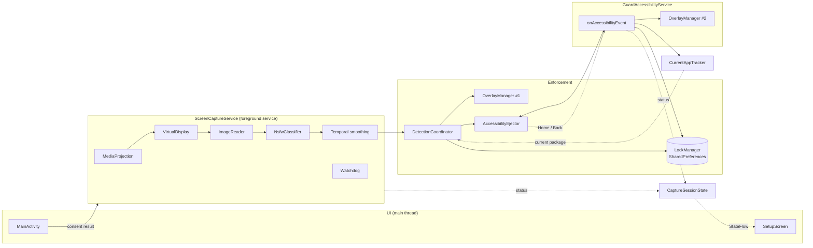
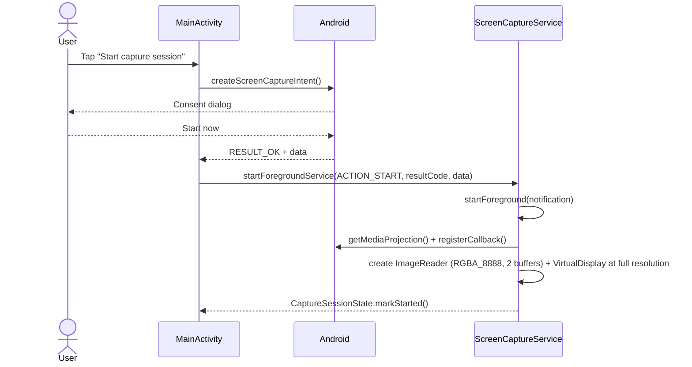
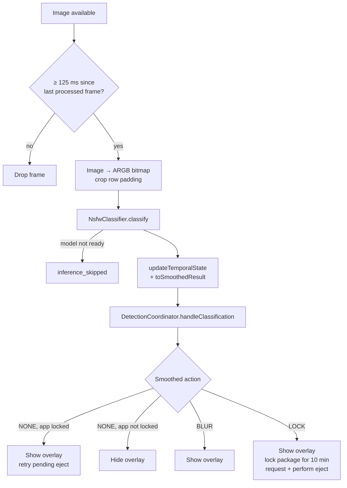
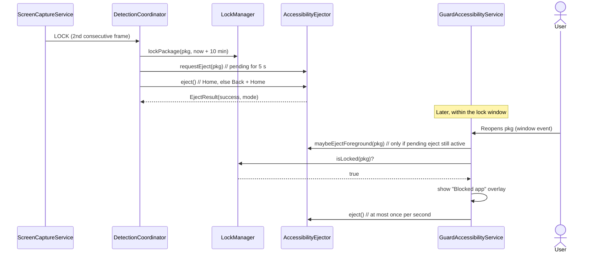

# Architecture

This document describes how the **current** GuardAI prototype is built. For the proposed system-level design, see [SYSTEM_LEVEL_ARCHITECTURE.md](../SYSTEM_LEVEL_ARCHITECTURE.md).

## Goals and constraints

GuardAI runs as an ordinary, sideloaded Android app. It has no root or system privileges, so it is built from the public APIs that a normal app can use:

| Need | Android API used | Consequence |
| --- | --- | --- |
| See what is on screen | `MediaProjection` + `VirtualDisplay` + `ImageReader` | User consent every session; a persistent notification; the session can be stopped by the user or the system. |
| Hide content | `TYPE_APPLICATION_OVERLAY` window (`SYSTEM_ALERT_WINDOW`) | Needs the *Display over other apps* permission. The overlay appears in the screen capture too. |
| Know the foreground app and leave it | `AccessibilityService` events and `performGlobalAction` | Needs the user to enable the service by hand. The foreground app is inferred from events. |
| Detect explicit content | TensorFlow Lite on the CPU | Runs on-device, with no network access. |

## Components

| Component | File | Responsibility |
| --- | --- | --- |
| `GuardAIApplication` | `GuardAIApplication.kt` | Creates the low-importance `guardai_capture` notification channel. |
| `MainActivity` | `MainActivity.kt` | Hosts the setup screen, opens permission settings, launches the screen-capture consent dialog, runs debug lock and unlock actions. |
| `SetupScreen` | `ui/setup/SetupScreen.kt` | Stateless Compose UI. Renders `CaptureUiState` and forwards button taps. |
| `ScreenCaptureService` | `service/ScreenCaptureService.kt` | Owns the `MediaProjection` session, frame sampling, inference, temporal smoothing, the stall watchdog and the foreground notification. |
| `NsfwClassifier` | `ai/NsfwClassifier.kt` | Loads the TFLite model, preprocesses frames, decodes detections, applies thresholds and NMS, and returns a `DetectionSummary` (`NONE`, `BLUR` or `LOCK`). |
| `DetectionCoordinator` | `detection/DetectionCoordinator.kt` | Maps a smoothed decision to actions: show or hide the overlay, store a lock, request an eject. Returns a `DetectionOutcome`. |
| `OverlayManager` | `overlay/OverlayManager.kt` | Adds or removes one full-screen opaque black window. All window operations are posted to the main thread. |
| `LockManager` | `lock/LockManager.kt` | Stores `packageName → expiresAt` (wall-clock ms) in the private `guardai_locks` preferences. Expired entries are removed when read. |
| `GuardAccessibilityService` | `service/GuardAccessibilityService.kt` | Receives window events, updates the tracked foreground app, retries pending ejects, and blocks and ejects locked apps when they are reopened. |
| `AccessibilityEjector` | `accessibility/AccessibilityEjector.kt` | Singleton holding a weak reference to the accessibility service. Performs Home (falls back to Back + Home) on the main thread and tracks one pending eject with a retry window. |
| `CurrentAppTracker` | `tracking/CurrentAppTracker.kt` | `StateFlow` holding the last non-blank foreground package. |
| `CaptureSessionState` | `session/CaptureSessionState.kt` | Process-wide `StateFlow<CaptureUiState>` used by the services to report status to the UI. |
| `MetricsLogger` | `metrics/MetricsLogger.kt` | Writes structured `key=value` events to logcat. See [metrics.md](metrics.md). |

> **Two overlay instances.** `DetectionCoordinator` and `GuardAccessibilityService` each create their own `OverlayManager`. Each instance only removes the view it added, so the capture path cannot clear a "Blocked app" overlay shown by the accessibility service, and the other way round.

## Threading model

| Thread | What runs there |
| --- | --- |
| Main | Activity and Compose UI, accessibility events, overlay add and remove, global actions (Home/Back), the watchdog timer. |
| `guardai-capture` (`HandlerThread`) | `ImageReader` callbacks, bitmap conversion, TFLite inference (4 threads inside the interpreter), smoothing and `DetectionCoordinator` calls. |

Inference runs synchronously on the capture thread, so the real frame rate is the lower of 8 fps (the 125 ms sample interval) and `1 / inference latency`. Frames that arrive while the thread is busy are dropped by `acquireLatestImage()`.

When the capture thread requests an eject, `AccessibilityEjector` posts the work to the main thread and blocks for up to **300 ms** waiting for the result. If the main thread is busy, the result is `TIMEOUT`.

## Runtime flows

### Starting a session

The model is loaded in `ScreenCaptureService.onCreate()` (`classifier.warmUp()`). If loading fails, frames are still captured but inference is skipped, and the UI says *Model file not loaded yet*.

### Processing a frame

How the raw per-frame decision is made, and how smoothing turns it into the action above, is covered in [detection.md](detection.md).

### Locking and re-entry

When a window event arrives from an app that is **not** locked, the accessibility service removes its own overlay and clears any pending eject.

### Ejection strategy

`AccessibilityEjector.eject()` returns an `EjectResult` with one of these modes:

| Mode | Meaning |
| --- | --- |
| `HOME` | `GLOBAL_ACTION_HOME` succeeded. |
| `BACK_HOME` | Home failed. Back was sent, then after 80 ms Home succeeded. |
| `BACK_ONLY` | Back succeeded but the second Home failed. |
| `FAILED` | Neither action succeeded. |
| `NO_SERVICE` | The accessibility service isn't connected. |
| `TIMEOUT` | The main thread didn't run the action within 300 ms. |
| `NO_RESULT` | The action ran but produced no result (should not happen). |

The latest result is shown on the setup screen and in an alert dialog.

### Watchdog

Every 1.5 s, the watchdog checks whether a frame has been processed in the last 3 s. If not, it tears down and rebuilds the `ImageReader` and `VirtualDisplay`, up to 3 times per session. After that it only reports a terminal stall in diagnostics.

`VirtualDisplay` only produces frames when screen content changes, so a static screen can also look like a stall.

> On Android 14 (API 34) and later, an app targeting API 34 can call `createVirtualDisplay` only once per `MediaProjection`. A watchdog restart is therefore expected to fail on those versions; start a new capture session instead.

### Stopping

The session ends when any of these happens:

- the user taps **Stop protection** (in the app or the notification), which sends `ACTION_STOP`;
- the system calls `MediaProjection.Callback.onStop()`, for example when the user stops sharing from the status bar;
- the service is destroyed.

`onDestroy()` removes the capture overlay, releases the capture resources, stops the projection, logs `session_end`, and marks the UI state as stopped. Locks in `LockManager` are **not** cleared.

## State and persistence

| State | Where | Lifetime |
| --- | --- | --- |
| App locks | `SharedPreferences` `guardai_locks` (`package → expiresAt` in epoch ms) | Survives restarts until it expires, until **Unlock All**, or until app data is cleared. Uses wall-clock time, so changing the device clock changes the expiry. |
| UI state (`CaptureUiState`) | In-memory `StateFlow` | Process lifetime. |
| Tracked foreground app | In-memory `StateFlow` | Process lifetime. |
| Pending eject | In-memory fields in `AccessibilityEjector` | 5 s retry window, or until it succeeds or is cleared. |
| Smoothing streaks | Fields in `ScreenCaptureService` | Reset whenever the pipeline is rebuilt. |

## Permissions

| Permission or setting | Why |
| --- | --- |
| `SYSTEM_ALERT_WINDOW` | Draw the black overlay over other apps. |
| `FOREGROUND_SERVICE`, `FOREGROUND_SERVICE_MEDIA_PROJECTION` | Run the capture service in the foreground with type `mediaProjection`. |
| `POST_NOTIFICATIONS` | Show the ongoing *GuardAI active* notification (Android 13+). |
| `BIND_ACCESSIBILITY_SERVICE` (on the service) | Lets the system bind `GuardAccessibilityService`. It listens for `typeWindowStateChanged` and `typeWindowContentChanged` from all packages. |
| Screen-capture consent | Granted at runtime through the `MediaProjection` dialog, every session. |

GuardAI doesn't request `INTERNET`.
