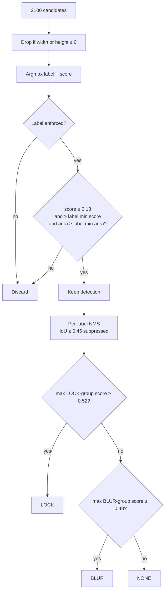

# Detection pipeline

This document explains how a captured frame becomes a `NONE`, `BLUR` or `LOCK` decision. The code is in [`ai/NsfwClassifier.kt`](../app/src/main/java/com/guardai/ai/NsfwClassifier.kt) (per-frame decision) and [`service/ScreenCaptureService.kt`](../app/src/main/java/com/guardai/service/ScreenCaptureService.kt) (temporal smoothing).

For proposed improvements, see [DETECTOR_IMPROVEMENT_PLAN.md](../DETECTOR_IMPROVEMENT_PLAN.md).

## Model

| Property | Value |
| --- | --- |
| Asset loaded | `assets/models/320n_float32.tflite` (`NsfwClassifier.MODEL_PATH`) |
| Architecture | NudeNet 320n detector (a YOLOv8-nano-style single-stage detector) converted to TFLite |
| Runtime | `org.tensorflow:tensorflow-lite:2.16.1`, CPU, 4 interpreter threads, no GPU or NNAPI delegate |
| Loading | Memory-mapped from the APK. `tflite` files are stored uncompressed (`androidResources.noCompress`). |
| Input | `float32[1, 320, 320, 3]`, NHWC, RGB scaled to `[0, 1]` |
| Output | `float32[1, 22, 2100]`: 4 box rows and 18 class-score rows, for 2100 candidate boxes |

`nudenet_int8.tflite` is also in the assets folder but **is not loaded** by the current code.

### Preprocessing

1. The `ImageReader` frame (RGBA_8888, full display resolution) is copied into an `ARGB_8888` bitmap, and row padding is cropped off.
2. The bitmap is scaled to 320×320 with `Bitmap.createScaledBitmap(..., filter = true)`. **This stretches the image; it does not letterbox.** On a 20:9 phone screen, content is squashed vertically by about 2.2×, which can hurt accuracy.
3. Pixels are written as `R/255, G/255, B/255` floats into a reused direct buffer. Alpha is ignored.

### Output decoding

For each of the 2100 candidates:

- Rows `0–3` are the box centre `x`, centre `y`, width and height, in input-pixel units (0–320).
- Rows `4–21` are the scores for the 18 labels, in the order of the `DetectorLabel` enum.
- The candidate is assigned the single label with the highest score (argmax).

## Labels

The model outputs 18 labels. Only 9 of them affect enforcement; the others are decoded and then ignored.

| Label | Group | Min score | Min area | Effective trigger score |
| --- | --- | --- | --- | --- |
| `ARMPITS_EXPOSED` | BLUR | 0.50 | 2.0 % | **0.50** |
| `FEET_EXPOSED` | BLUR | 0.55 | 3.0 % | **0.55** |
| `BELLY_EXPOSED` | LOCK | 0.52 | 8.0 % | **0.52** |
| `BUTTOCKS_EXPOSED` | LOCK | 0.48 | 3.5 % | **0.52** |
| `FEMALE_BREAST_EXPOSED` | LOCK | 0.46 | 2.0 % | **0.52** |
| `MALE_BREAST_EXPOSED` | LOCK | 0.58 | 3.0 % | **0.58** |
| `FEMALE_GENITALIA_EXPOSED` | LOCK | 0.44 | 0.8 % | **0.52** |
| `MALE_GENITALIA_EXPOSED` | LOCK | 0.44 | 0.8 % | **0.52** |
| `ANUS_EXPOSED` | LOCK | 0.44 | 0.8 % | **0.52** |

Ignored labels: `FACE_FEMALE`, `FACE_MALE`, and every `*_COVERED` label.

- **Min area** is the box area as a fraction of the 320×320 input, after clamping the box to the frame.
- **Effective trigger score** is the lowest score at which the label changes the decision: the larger of its minimum score and its group's trigger threshold (`BLUR_TRIGGER_THRESHOLD = 0.48`, `LOCK_TRIGGER_THRESHOLD = 0.52`).

> A LOCK-group detection that passes its minimum score but stays below 0.52 (for example, `FEMALE_GENITALIA_EXPOSED` at 0.47) is kept as a detection but produces **no action**. The BLUR fallback only looks at BLUR-group labels. Lowering a LOCK label's minimum score below 0.52 has no effect unless `LOCK_TRIGGER_THRESHOLD` is lowered too.

## Per-frame decision

`classify()` returns a `DetectionSummary`:

| Field | Meaning |
| --- | --- |
| `action` | `NONE`, `BLUR` or `LOCK` for this frame alone. |
| `confidence` | Highest score among the kept detections (0 if none). |
| `topLabel` | Label of that detection. Defaults to `FACE_FEMALE` when there are none; ignore it when `confidence` is 0. |
| `matchedLabels` | Distinct labels among the kept detections. |
| `detections` | Kept boxes, normalized to `[0, 1]`, sorted by score. |

It returns `null` if the model could not be loaded.

## Temporal smoothing

Single frames are noisy, so `ScreenCaptureService` keeps two counters and adjusts the frame's decision before acting on it.

**Updating the counters** (`updateTemporalState`):

| Raw action | `lockFrameStreak` | `blurFrameStreak` | Blur hold |
| --- | --- | --- | --- |
| `LOCK` | +1 | +1 | now + 1.5 s |
| `BLUR` | reset to 0 | +1 | now + 1.5 s |
| `NONE` | reset to 0 | reset to 0 only after the hold has passed | unchanged |

**Smoothed action** (`toSmoothedResult`):

| Raw action | Condition | Smoothed action |
| --- | --- | --- |
| `LOCK` | `lockFrameStreak ≥ 2` | `LOCK` |
| `LOCK` | first LOCK frame | `BLUR` |
| `BLUR` | always | `BLUR` |
| `NONE` | always | `NONE` |

What this means in practice:

- **BLUR fires on the first frame.** There is no extra delay before the overlay appears.
- **LOCK needs two consecutive LOCK frames.** At the 125 ms sample interval that is at least ~250 ms, plus inference time. The first LOCK frame shows the overlay without locking.
- **A single NONE frame breaks a LOCK streak.**
- **The 1.5 s hold doesn't keep the overlay up.** A `NONE` frame removes the capture overlay even inside the hold window, because `DetectionCoordinator` hides it for any `NONE` frame on an unlocked app. The hold only affects when `blurFrameStreak` resets.

## Tuning

All the values above are constants. [configuration.md](configuration.md) lists where each one lives. Some guidelines:

- **Change one threshold at a time** and compare `decision_*` events before and after on the same test content (see [metrics.md](metrics.md#analyzing-a-session)).
- **Keep the trigger thresholds in mind.** A label's effective score is `max(min score, group trigger)`, as shown in the [labels table](#labels).
- **Area filters catch thumbnails and false positives.** Raising a min area ignores small detections, such as feed thumbnails. Lowering it catches small explicit regions but increases false positives.
- **Changing the model** requires updating `MODEL_PATH`, `INPUT_SIZE`, `OUTPUT_CHANNELS`, `OUTPUT_CANDIDATES` and the `DetectorLabel` order to match the new model's output exactly. A wrong label order fails silently: the app keeps running, but decisions are wrong.
